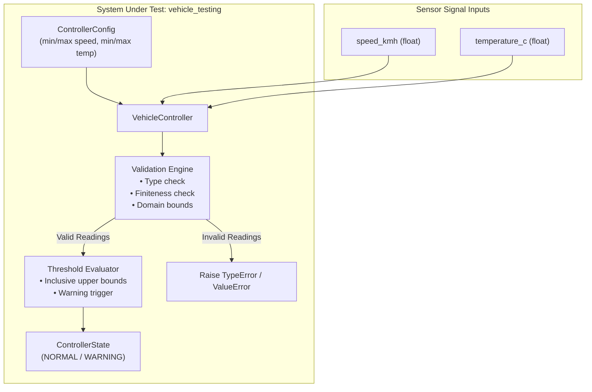
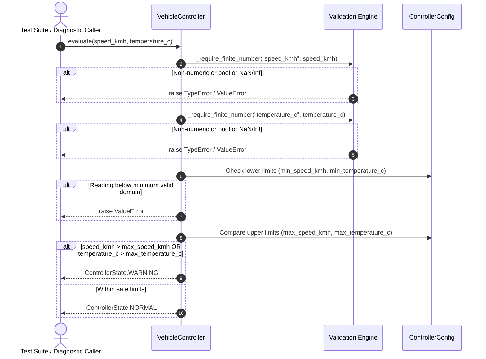
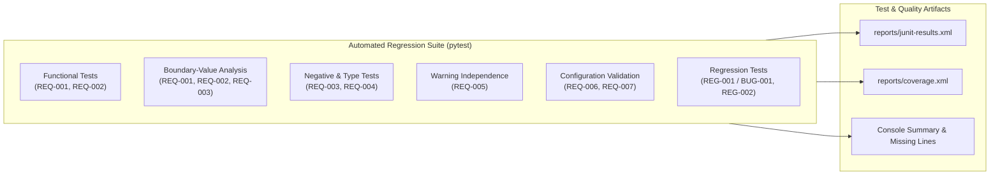
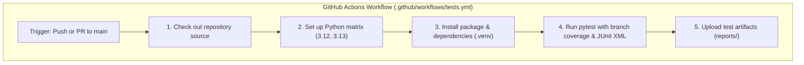

# Architecture Overview — Automotive Regression Testing Framework

This document describes the software design, execution flow, automated testing architecture, and continuous integration pipeline for the Automotive Regression Testing Framework.

---

## 1. System Architecture

The framework consists of a domain-modeled vehicle monitoring controller and a multi-tiered automated verification suite.

### Component Details
1. **`ControllerState`**:
   - Enumeration of legal operational monitoring states: `NORMAL` (`"normal"`) and `WARNING` (`"warning"`).
2. **`ControllerConfig`**:
   - Immutable frozen dataclass encapsulating physical sensor constraints and operational thresholds.
   - Self-validating in `__post_init__`: guarantees finite numbers, rejects boolean types, and enforces `min_speed_kmh >= 0.0`, `min_speed_kmh < max_speed_kmh`, and `min_temperature_c < max_temperature_c`.
3. **`VehicleController`**:
   - Encapsulates domain logic.
   - `_require_finite_number(name, value)`: Strictly validates numeric type (explicitly rejecting Python `bool`) and ensures non-NaN, non-infinite values.
   - `evaluate(speed_kmh, temperature_c)`: Deterministically compares inputs against configured boundaries. Upper limits are inclusive safe bounds.

---

## 2. Evaluation Data Flow

---

## 3. Automated Testing Architecture

The verification suite is structured to guarantee full requirement coverage, boundary protection, and regression immunity:

---

## 4. Continuous Integration Pipeline Workflow

Both GitHub Actions and Azure DevOps execute this test and report-generation sequence, providing automated verification across supported Python environments.
